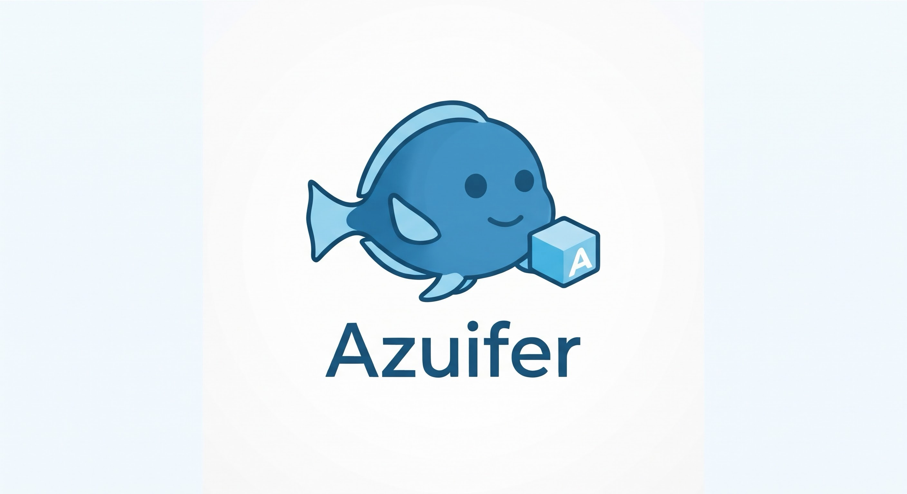

# Azuifer

<p align="center">
  
</p>

Azuifer is an independent Rust project for emulating the Azure Storage data plane locally. The first runnable slice serves a subset of Blob Storage. Data Lake Storage Gen2 (DFS), Azure Files FileREST, Queue, and Table remain targets; the proposed Blob and DFS implementations will share a namespace for HNS accounts.

**Status: early development.** The supported routes work locally and are tested over HTTP. This build has not been differential-tested against Azure and does not claim parity. It is not a production storage service or an Azure management-plane emulator.

The [Azure Linux container](docs/compatibility/blob.md#container) is the primary way to run Azuifer. The same Rust workspace targets native macOS, Linux, and Windows for local development and testing.

## Run locally

Install Rustup and a native C toolchain for bundled SQLite: Command Line Tools on macOS, GCC or Clang on Linux, or MSVC Build Tools on Windows. From the repository root:

```sh
cargo run --locked -- serve --in-memory
```

Blob listens on `127.0.0.1:10000`; the admin listener serves `/healthz` and `/readyz` on `127.0.0.1:10005`. Stop with Ctrl+C. To keep data across runs, use `serve --location ./data` instead. A persistent directory is dedicated to one running Azuifer process.

Point a Blob client at `http://127.0.0.1:10000/devstoreaccount1`. Use Shared Key and set API version `2023-11-03`. Clients that accept `UseDevelopmentStorage=true` can use its Blob endpoint and credentials with that API version. The well-known development key is allowed only on loopback. For your own development key, put its Base64 value in `AZUIFER_ACCOUNT_KEY` and optionally set `AZUIFER_ACCOUNT_NAME`.

The [local Blob guide](docs/compatibility/blob.md) lists the implemented operations, flags, and container setup. For the newer API version sent by `az storage`, see the [Azure CLI setup](docs/compatibility/blob.md#azure-cli). Export the version and operation inventory with `cargo run --locked -- conformance export`.

| Start here | What you'll find |
| --- | --- |
| [Product and technical specification](docs/specs/azuifer.md) | The proposed behavior, compatibility contract, and release criteria |
| [Onboarding](ONBOARDING.md) | How the pieces fit together and where to make a first contribution |
| [Architecture decision records](docs/adr.d/README.md) | Design choices, alternatives, and the evidence each choice will need |
| [Contributing](CONTRIBUTING.md) | How to propose, validate, and review changes |
| [Releases](docs/releases.md) | Native archives, the Azure Linux image, and Docker Hub opt-in |
| [Security policy](SECURITY.md) | How to report a security issue privately |
| [Agent instructions](AGENTS.md) | Constraints for automated contributors |

Azuifer is not affiliated with or endorsed by Microsoft. The repository is licensed under either the [MIT License](LICENSE-MIT) or the [Apache License 2.0](LICENSE-APACHE), at your option.
